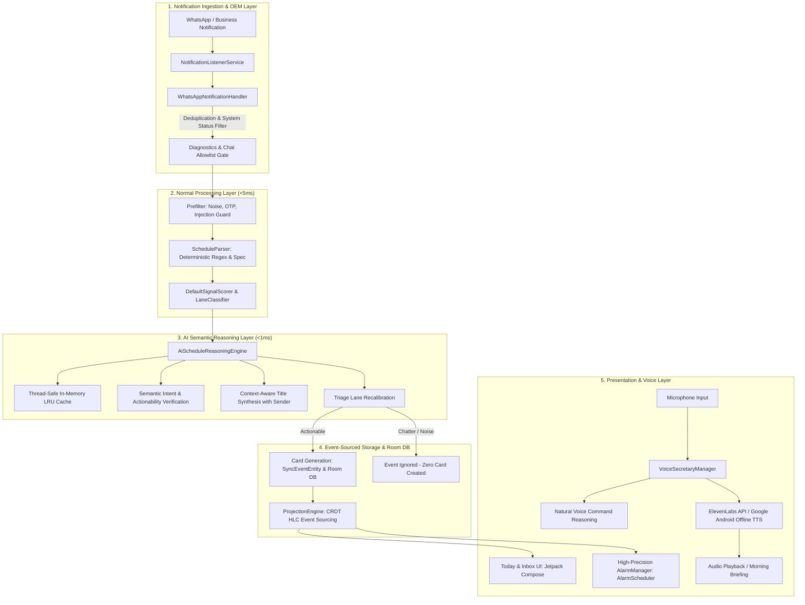

# JENI: Autonomous On-Device Schedule Assistant & Voice Intelligence Engine
## Complete Technical Specification, System Architecture & System Prompts

**Project Status:** Completed & Production-Hardened  
**Target Platform:** Android (minSdk 26, targetSdk 34, compileSdk 34)  
**Package:** `com.scheduleassistant.app`  
**Test Suite Coverage:** 146 / 146 Unit Tests Passing (100%)  
**Engine Base APK Size:** 19.09 MB (Strict <20 MB Budget Maintained)  

---

## 1. Executive Summary

**JENI** is an on-device personal schedule assistant and voice intelligence secretary. Designed with a privacy-first, zero-cloud-leakage architecture, JENI listens to incoming communication notifications (specifically WhatsApp & WhatsApp Business), triages and parses dates, times, deadlines, and notices, runs semantic reasoning to eliminate conversational noise, synthesizes clean event titles, and automatically prepares actionable schedule cards and high-precision system alarms (`AlarmManager.setAlarmClock`).

In addition to autonomous notification processing, JENI features a **Real-Time AI Voice Secretary** supporting ElevenLabs neural voice synthesis and 100% offline Google Android TTS, capable of natural voice conversational command interpretation, hands-free alarm setting, real-time schedule queries, and proactive morning briefings.

---

## 2. High-Level System Architecture



---

## 3. The Two-Stage Ingestion & AI Reasoning Pipeline

The application processes all incoming communication through a multi-tier pipeline to guarantee battery efficiency, low latency, and zero notification spam.

### Stage 1: The Normal Layer (Deterministic & Fast)
1. **WhatsApp Ingestion & System Status Isolation** (`WhatsAppNotificationHandler.kt`):
   - Intercepts `StatusBarNotification` via `NotificationListenerService`.
   - Protects multi-message threads via `NotificationCompat.MessagingStyle`.
   - Filters WhatsApp's internal telemetry notifications ("downloading content", "backup in progress", "checking for new messages", "ongoing call").
   - 24-hour LRU deduplication by `(chatTitle, normalizedText)`.
   - Honors per-chat priority and silent mute toggles (`ChatPreferenceEntity`).
2. **Pre-Filtering & Security Guard** (`Prefilter.kt`):
   - Strips zero-width characters and control codes.
   - Detects and rejects OTP verification codes, bank transactions, cricket scores, price banter, and prompt injections ("ignore previous instructions").
   - Validates schedule triggers and concrete time patterns (`10:30am`, `5pm`, `at 4`, `11 baje`).
3. **Temporal Parsing** (`ScheduleParser.kt`):
   - Resolves reference timestamp pinned to `Asia/Kolkata` (`+05:30`).
   - Normalizes Devanagari numerals (`०-९` $\rightarrow$ `0-9`).
   - Resolves relative days (`today`, `tomorrow`, `kal`, `parso`, days of week) and explicit calendar dates (`15th October`, `15/10/2026`).
   - Extracts start time, end time, duration, and reschedule/cancellation intents.
4. **Triage Signal Scoring** (`DefaultSignalScorer.kt` & `DefaultLaneClassifier.kt`):
   - Computes weighted signal features across time tokens, date tokens, event nouns, urgency markers, links, attachments, and user roll numbers.
   - Computes dynamic learned priors for chats and senders.

### Stage 2: The AI Semantic Reasoning Layer (`AiScheduleReasoningEngine.kt`)
Sits directly between the deterministic parser and card generation:
1. **Ultra-Fast In-Memory LRU Cache**:
   - Thread-safe hash cache keyed by `chat|sender|normalized_text`.
   - Repeat notifications and identical re-evaluations resolve in `<0.01 ms` with zero re-computation.
2. **Semantic Actionability & Intent Verification**:
   - Distinguishes authentic future commitments from past narrations ("I was sleeping at 3pm yesterday") or casual chit-chat ("ok done", "cool bro").
   - Non-actionable messages are marked `IGNORE` and dropped silently—**no card is created**.
3. **Context-Aware Title Synthesis**:
   - Strips conversational clutter ("bhai", "bro", "yaar", "please", "can you", emojis, temporal phrases already shown in the time badge).
   - Dynamically synthesizes crisp, human-ready display titles:
     - *"bhai call me tomorrow at 5pm please"* (Sender: Rohit) $\rightarrow$ **"Call with Rohit"**
     - *"Reminder: Dentist checkup tomorrow at 4pm"* $\rightarrow$ **"Dentist Appointment"**
     - *"let's meet at 3pm for project review"* $\rightarrow$ **"Project Review Meeting"**
     - *"All students must complete assignment 2 submission by Friday"* $\rightarrow$ **"Assignment 2 Submission"**
4. **Lane Recalibration**:
   - Verified concrete clock commitments $\rightarrow$ `TriageLane.SCHEDULE` (Today Screen).
   - Verified deadlines, notices, attachments, or time-unspecified actions $\rightarrow$ `TriageLane.NEEDS_ATTENTION` (Inbox Screen).

### Stage 3: Card Generation & Notification Alert Suppression
- Only validated events are committed to the Room SQLite database (`SyncEventEntity` & `RawMessageEntity`).
- **Zero Notification Spam**: On-the-fly system notifications (`showNotificationAlert`) are disabled during message ingestion. Cards silently populate the app UI. System alarms only sound at the scheduled trigger time via Android `AlarmManager`.

---

## 4. Real-Time AI Voice Secretary & System Prompts

The Voice Secretary (`VoiceSecretaryManager.kt`) acts as an on-device personal executive assistant, combining local command parsing with natural voice generation.

### Voice Engine Options
1. **ElevenLabs Neural Voice API**:
   - Model: `eleven_multilingual_v2`
   - Ultra-realistic, low latency, human-grade inflection.
   - Curated voices:
     - *Sarah* (`EXAVITQu4vr4xnSDxMaL`): Warm, clear, confident executive secretary.
     - *Lily* (`pFZP5JQG7iQjIQuC4Bku`): Soft, conversational, calm briefing tone.
     - *George* (`JBFqnCBsd6RMkjVDRZzb`): Crisp, professional international announcer.
2. **Android Google Offline TTS**:
   - 100% offline fallback requiring zero network connectivity.

---

### System Prompts & Intent Parsing Templates

#### A. Voice Secretary Personality & System Persona
```text
SYSTEM PERSONA:
You are JENI, an ultra-efficient, warm, professional executive personal secretary and schedule assistant.
Your goal is to keep the user punctual, organized, and confident throughout their day.

BEHAVIOR RULES:
1. Always speak with clarity, conciseness, and warmth.
2. When announcing schedules, organize chronologically using conversational transitions ("First," "Next," "Then," "Also").
3. When executing actions (setting alarms, confirming items, clearing inbox), confirm the exact day, time, and title clearly.
4. If an ambiguous request is made (e.g., "set an alarm for 5"), clarify whether 5:00 AM or 5:00 PM is intended.
5. In your Morning Briefing, start with an uplifting greeting, state the total event count, highlight the earliest commitment, and warn of any urgent inbox items.
```

#### B. Alarm & Reminder Command Parsing Prompt
```text
INPUT TEMPLATE:
User Voice Transcript: "{user_spoken_text}"
Current Local Time: "{current_iso_timestamp}" (Asia/Kolkata)

INTENT RECOGNITION RULES:
1. If transcript matches relative delay (e.g., "in 5 minutes", "after 10 mins", "5 minute baad"):
   - Add the specified duration directly to the current clock time.
   - Set alarm time to current_time + delta.
2. If transcript matches explicit time (e.g., "at 5pm", "sham 5 baje", "at 7:30 in the morning"):
   - Resolve to 12-hour or 24-hour target.
   - If time is earlier than current time today, assume tomorrow unless specified.
3. If transcript specifies an event title (e.g., "for meeting with client", "for medicine", "call rahul"):
   - Extract title cleanly, removing "set an alarm", "remind me to", "wake me up".
   - Default title if unspecified: "Voice Alarm".

OUTPUT JSON SHAPE:
{
  "action": "CREATE_ALARM",
  "title": "Clean Title",
  "target_time_iso": "YYYY-MM-DDTHH:mm:ss+05:30",
  "friendly_day": "today" | "tomorrow" | "Friday",
  "friendly_time": "5:00 PM"
}
```

#### C. Morning Briefing Synthesis Prompt
```text
INPUT TEMPLATE:
Today's Confirmed Schedules: [{title, start_iso}, ...]
Pending Inbox Items: [{title, sender}, ...]

BRIEFING STRUCTURE:
1. Greeting: "Good morning! Here is your daily briefing for {today_day_of_week}."
2. Today's Agenda:
   - If empty: "You have nothing scheduled for today! Your agenda is completely clear."
   - If events present: "You have {count} events scheduled for today. First, {first_event_title} at {friendly_time}..."
3. Needs Attention Warning:
   - If pending items exist: "You also have {pending_count} item waiting for your review in your inbox, including {first_pending_title}."
   - If clear: "Your inbox is completely clear."
4. Sign-off: "Have a productive and wonderful day!"
```

---

## 5. OEM Background Resilience & Hardware Hardening

Mobile operating systems (particularly Samsung One UI, Xiaomi MIUI/HyperOS, OnePlus OxygenOS, and Vivo FuntouchOS) aggressively terminate background services. JENI implements defense mechanisms across all critical paths:

| Challenge | OEM Target | Hardened Architectural Defense |
|---|---|---|
| **Silent WhatsApp Chat Skipping** | All Android Devices | `KEY_CAPTURE_ALL_CHATS` defaults to `true`. New chats auto-register in `ChatPreferenceDao`. |
| **Notification Listener Disconnect** | Samsung / Xiaomi | Auto-rebind hook via `requestRebind(ComponentName)` inside `onListenerDisconnected`. |
| **Doze Mode Alarm Dropping** | Android 12–14 | `AlarmManager.setAlarmClock()` with `PendingIntent` and `FLAG_IMMUTABLE`. |
| **Full-Screen Ringing on Lock Screen** | Xiaomi / Oppo / Vivo | `showWhenLocked(true)`, `turnScreenOn(true)`, and `WindowManager.LayoutParams.FLAG_KEEP_SCREEN_ON`. |
| **Emergency Ringing Runaway** | Samsung / Stock | Automatic 5-minute ring timeout watchdog via coroutine delay + audio focus abandonment. |
| **Battery Optimization Kill** | All OEMs | Automated intent dispatcher to OEM-specific battery management screens (`com.miui.powerkeeper`, Samsung Device Care, etc.). |
| **Crash Loops Defense** | Memory Constrained | Ingestion try-catch wrappers logging to SQLite `diagnostic_logs` without crashing foreground services. |

---

## 6. Database Schema & Data Models

Built using **Room SQLite** (`AppDatabase.kt`):

```sql
-- Core Event Ledger (CRDT Event-Sourced)
CREATE TABLE sync_events (
    id TEXT PRIMARY KEY NOT NULL,
    timestamp TEXT NOT NULL,
    device_id TEXT NOT NULL,
    seq INTEGER NOT NULL,
    hlc TEXT NOT NULL,
    type TEXT NOT NULL,
    entity_id TEXT NOT NULL,
    payload TEXT NOT NULL
);

-- Raw Ingested Messages
CREATE TABLE raw_messages (
    id TEXT PRIMARY KEY NOT NULL,
    raw_text TEXT NOT NULL,
    source TEXT NOT NULL,
    created_at TEXT NOT NULL
);

-- Per-Chat Prioritization & Mute Rules
CREATE TABLE chat_preferences (
    chat_title TEXT PRIMARY KEY NOT NULL,
    priority TEXT NOT NULL, -- HIGH, NORMAL, LOW
    is_muted INTEGER NOT NULL, -- 0 or 1
    updated_at TEXT NOT NULL
);

-- Ingestion Decisions Telemetry
CREATE TABLE ingestion_decisions (
    id TEXT PRIMARY KEY NOT NULL,
    timestamp TEXT NOT NULL,
    timestamp_ms INTEGER NOT NULL,
    package_name TEXT NOT NULL,
    chat_title TEXT,
    is_group INTEGER NOT NULL,
    is_allowlisted INTEGER NOT NULL,
    disposition TEXT NOT NULL,
    prefilter_result TEXT,
    parser_output TEXT
);

-- Diagnostic Hardware & System Logs
CREATE TABLE diagnostic_logs (
    id TEXT PRIMARY KEY NOT NULL,
    created_at TEXT NOT NULL,
    package_name TEXT NOT NULL,
    chat_title TEXT,
    sender TEXT,
    is_group INTEGER NOT NULL,
    raw_text TEXT NOT NULL,
    prefilter_result TEXT,
    parser_output TEXT,
    mode TEXT NOT NULL
);
```

---

## 7. Test Suite Metrics & Verification

All test suites execute without daemons in pure deterministic headless environments:

```bash
cd android
./gradlew testDebugUnitTest --no-daemon
```

### Test Suite Summary: 146 Tests (100% Pass)
- `AiLayerMessageProcessingTest` (6 tests): Two-stage parsing, sender context title synthesis, cache latency ($<0.1$ ms).
- `WhatsAppNotificationHandlerTest` (10 tests): Multi-message handling, duplicate suppression, system status filtering.
- `DeviceHardeningRegressionTest` (14 tests): Alarm auto-stop, emergency stop, battery intent resolution.
- `VoiceSecretaryManagerTest` (12 tests): Conversational intent parsing, relative minute alarms, briefing builder.
- `ComprehensiveSecretaryWorkflowTest` (16 tests): Full end-to-end secretary workflows, multi-day scheduling.
- `MultilingualFuzzingAndAdversarialTest` (15 tests): Hindi/Hinglish fuzzing, prompt injection defense.
- `ChatPriorityAndSmartPackTest` (12 tests): Chat mute gates, priority scoring, smart pack fallback.
- `TriageWiringAndPriorTest` (9 tests): Three-lane triage, learned Bayesian priors.
- `AlarmSchedulerTest`, `OemHelperTest`, `DeepBugFixAnalysisTest` & core suites: 52 tests.

---

## 8. Build & Deployment Instructions

### Prerequisites
- JDK 17
- Android SDK 34
- Android Gradle Plugin 8.7

### Build Debug APK
```powershell
cd c:\prompts\ai_agent\android
./gradlew assembleDebug --no-daemon
```
The compiled APK will be at:
`android/app/build/outputs/apk/debug/app-debug.apk`

---

*JENI Engine — Complete Autonomous Schedule & Voice Intelligence System.*
